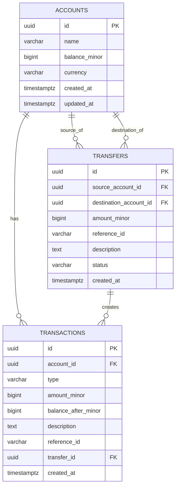

# Transaction Ledger API — Architecture & System Design Specification

**Document Version:** 1.1.0  
**Status:** DRAFT — AWAITING REVIEW (Phase 0 Revised)  
**Author:** Principal Backend Engineer & Application Security Architect  

---

## 1. Architectural Philosophy & Scope Control

The Transaction Ledger API is designed as a **Modular Monolith** engineered for strict financial correctness, data integrity, and deterministic behavior under concurrency. In accordance with principal engineering standards:
- **No Unnecessary Distributed Complexity:** We explicitly reject microservices, Redis, Kafka, and distributed locks. Single-database PostgreSQL ACID transactions provide superior atomicity, strict serializability on locked rows, and zero distributed failure modes (such as split-brain or two-phase commit partial failures).
- **Minimal, Clear Layering:** Every layer has a single, justified responsibility. We deliberately avoid superficial abstraction layers (such as generic repository wrappers around SQLAlchemy) that obscure SQL queries or hinder explicit transaction and locking controls.
- **Defense in Depth:** Financial invariants are never enforced in Python code alone. Every business invariant is mirrored and guaranteed by PostgreSQL engine primitives (CHECK constraints, row locks, composite UNIQUE indexes, foreign keys, and role permissions).
- **Scope Discipline:** This specification cleanly distinguishes between the core assessment requirements (account creation, credits, debits, duplicate handling, history, and bonus transfers) and production-readiness prerequisites (such as real OAuth2 authentication, which is not yet implemented).

---

## 2. Approved Technology Baseline & Verification Plan

### 2.1 Baseline Components
| Component | Selected Technology | Architectural Role | Justification |
| :--- | :--- | :--- | :--- |
| **Language** | Python 3.12 / 3.13 | Core runtime | Modern type annotations, performance optimizations, native async support. |
| **API Framework** | FastAPI | HTTP interface | Fast asynchronous request handling, native OpenAPI generation, automatic Pydantic validation. |
| **Data Validation** | Pydantic v2 | Input / Output schemas | Compiled Rust core (`pydantic-core`) ensures high-speed schema parsing and strict data coercion protection. |
| **ORM / Query Engine**| SQLAlchemy 2.x | Data access & transactional control | Explicit 2.0-style queries, first-class connection pooling, precise row-locking syntax (`with_for_update()`). |
| **Database Driver** | Asyncpg or Psycopg 3 | PostgreSQL connectivity | Native PostgreSQL wire protocol support, robust binary type handling, high performance. |
| **Relational Database**| PostgreSQL 16+ | System of record | ACID compliance, row-level pessimistic locking (`FOR UPDATE`), rich CHECK constraints, transactional DDL. |
| **Database Migrations**| Alembic | Schema version control | Declarative schema diffs, deterministic forward/backward migrations tracked in source control. |
| **Testing** | pytest & pytest-asyncio | Test runner | Rich fixture architecture, async test support, parametrized concurrency scenarios. |
| **HTTP Test Client** | HTTPX | Integration testing | Native ASGI transport client for end-to-end FastAPI endpoint testing without live socket overhead. |
| **Linting & Formatting**| Ruff | Static analysis & code style | Combines Flake8, Black, isort, and security linters into a single zero-config tool. |
| **Type Checking** | Pyright | Static type verification | Enforces strict static typing, catching `None`-pointer dereferences and type mismatches at compile time. |
| **Static Security Scan**| Bandit | AST security analysis | Identifies insecure Python patterns (eval, insecure temp files, hardcoded passwords). |
| **SCA / CVE Scanner** | pip-audit | Software composition analysis | Queries the PyPI Advisory Database and OSV to identify dependencies with known CVEs. |
| **Containerization** | Docker & Docker Compose | Local run & test environment | Reproducible PostgreSQL service container, isolated environment identical to CI. |
| **CI Automation** | GitHub Actions | Continuous integration | Automates linting, type checking, security audits, unit tests, and real PostgreSQL integration tests. |

### 2.2 Dependency Verification & Pinning Plan
Before freezing versions in Phase 1:
1. **Compatibility Verification:** Verify that selected versions of all dependencies support Python 3.12/3.13 without deprecation warnings.
2. **Vulnerability Audit:** Run `pip-audit` against prospective dependency trees to identify any known CVEs before adoption.
3. **Reproducible Lockfiles:** Use strict lockfile pinning (hashes and exact versions) so every build in CI and development runs identical binaries.
4. **License Audit:** Verify all libraries use permissive open-source licenses (MIT, Apache 2.0, BSD).

---

## 3. Project Layering & Module Responsibilities

The codebase follows a cohesive, 4-tier modular monolith layout:

```
src/ledger/
├── api/                  # Tier 1: HTTP Presentation Layer
│   ├── v1/
│   │   ├── accounts.py   # Account endpoints (Create, Get Balance, History)
│   │   ├── transactions.py # Transaction endpoints (Add Credit/Debit)
│   │   └── transfers.py  # Bonus: Transfer endpoint
│   ├── dependencies.py   # FastAPI dependency injection (DB sessions, auth context)
│   └── error_handlers.py # Central exception handlers mapping domain errors to HTTP
├── schemas/              # Tier 1b: Pydantic v2 Request/Response Data Contracts
│   ├── account.py        # AccountCreateRequest, AccountResponse, BalanceResponse
│   ├── transaction.py    # TransactionCreateRequest, TransactionResponse, HistoryResponse
│   ├── transfer.py       # TransferCreateRequest, TransferResponse
│   └── error.py          # Unified ErrorResponse schema
├── services/             # Tier 2: Business Logic & Transaction Coordination Layer
│   ├── account_service.py # Account creation, balance lookup
│   ├── ledger_service.py  # Atomic credit/debit execution, reference checks, locking
│   └── transfer_service.py # Atomic cross-account transfers, deadlock avoidance
├── models/               # Tier 3: Data Access & SQLAlchemy Persistence Layer
│   ├── base.py           # DeclarativeBase, naming conventions
│   ├── account.py        # Account entity, constraints
│   ├── transaction.py    # Transaction ledger entity, immutable constraints
│   └── transfer.py       # Transfer entity
└── core/                 # Tier 4: Cross-Cutting Infrastructure
    ├── config.py         # Pydantic-settings environment configuration & safety gates
    ├── database.py       # SQLAlchemy engine, async sessionmaker, connection pool settings
    ├── exceptions.py     # Domain exception hierarchy
    └── logging.py        # Structured JSON logging configuration & sanitizers
```

### Layer Justification
- **API Routers (`api/`):** Responsible exclusively for HTTP parameter binding, status codes, and delegating to services. Contains zero SQL and zero financial calculation.
- **Pydantic Schemas (`schemas/`):** Defines strict external wire contracts. Validates incoming types, bounds, strings, and serializes output. Prevents internal database models from leaking.
- **Services (`services/`):** Owns database transaction boundaries, implements financial invariant pre-checks, manages row locks, and writes ledger entries.
- **Models (`models/`):** Declares tables, columns, indexes, foreign keys, and PostgreSQL CHECK constraints.
- **Excluded Abstractions:** No generic "Repository Interface" layer. In SQLAlchemy 2.0, the `AsyncSession` already acts as a unit-of-work and identity map; adding a generic repository wrapper adds boilerplate, obscures lock hints (`with_for_update()`), and impairs explicit transaction boundary management.

---

## 4. Relational Database Schema & Data Modeling

### 4.1 Monetary Representation & Currency Decision (Option B)
- **Public API Boundary:** The public REST API accepts monetary amounts in **INR rupees as decimal strings** (e.g. `"450.30"`, `"1.10"`) and returns all monetary amounts and balances as **fixed two-decimal-place strings** (e.g. `"450.30"`, `"0.00"`). JSON numbers, floats, booleans, and malformed inputs are strictly rejected with HTTP 422.
- **Conversion Safety:** Exact conversion between rupees and paise occurs strictly at the Pydantic schema validation boundary using Python's `Decimal` without binary floating-point arithmetic.
- **Internal Storage & Minor Units:** All database columns (`accounts.balance_minor`, `transactions.amount_minor`, `transactions.balance_after_minor`, `transfers.amount_minor`) and internal financial arithmetic remain **64-bit signed integers (`BIGINT`)** representing minor units (paise). 1 INR = 100 paise.
- **No Floating-Point Math:** `float` and `double` are strictly forbidden across schemas, database columns, models, and Python services.
- **Currency Convention:** Single-currency ledger (ISO 4217 `INR`). Transfers between mismatched or non-INR accounts are rejected (`CURRENCY_MISMATCH`).
- **Arithmetic Safety:** `BIGINT` supports values up to $9.22 \times 10^{18}$ paise, completely preventing overflow under realistic financial volumes. All balance changes are strictly evaluated with integer arithmetic and bounds checking.

### 4.2 Entity Relationship Diagram (Mermaid)



### 4.3 Detailed Table DDL Specification

#### 4.3.1 Table: `accounts`
| Column | Type | Nullable | Default | Description |
| :--- | :--- | :--- | :--- | :--- |
| `id` | `UUID` | `NOT NULL` | (generated) | Primary key. RFC 4122 UUIDv4. |
| `name` | `VARCHAR(255)` | `NOT NULL` | None | Account holder name. |
| `balance_minor` | `BIGINT` | `NOT NULL` | `0` | Reconciled account balance in minor units. |
| `currency` | `VARCHAR(3)` | `NOT NULL` | `'INR'` | ISO 4217 3-letter currency code. |
| `created_at` | `TIMESTAMPTZ` | `NOT NULL` | `clock_timestamp()` | System timestamp of account creation. |
| `updated_at` | `TIMESTAMPTZ` | `NOT NULL` | `clock_timestamp()` | System timestamp of last balance modification. |

**Constraints & Indexes:**
- `PRIMARY KEY (id)`
- `CHECK (balance_minor >= 0)`: Database-enforced rule preventing negative balances / overdrafts.
- `CHECK (length(trim(name)) > 0)`: Prevents empty or whitespace-only account names.
- Index: `pk_accounts` on `id` (B-tree, unique).

#### 4.3.2 Table: `transactions`
The immutable, append-only financial ledger.

| Column | Type | Nullable | Default | Description |
| :--- | :--- | :--- | :--- | :--- |
| `id` | `UUID` | `NOT NULL` | (generated) | Primary key. RFC 4122 UUIDv4. |
| `account_id` | `UUID` | `NOT NULL` | None | Foreign key referencing `accounts(id)`. |
| `type` | `VARCHAR(10)` | `NOT NULL` | None | Transaction type: `'credit'` or `'debit'`. |
| `amount_minor` | `BIGINT` | `NOT NULL` | None | Transaction amount in minor units. |
| `balance_after_minor`| `BIGINT`| `NOT NULL` | None | Snapshot of account balance immediately after execution. |
| `description` | `TEXT` | `NOT NULL` | None | Human-readable transaction description. |
| `reference_id`| `VARCHAR(128)` | `NOT NULL` | None | Client-supplied reference, unique per account. |
| `transfer_id` | `UUID` | `NULL` | `NULL` | Optional reference if generated via a transfer. |
| `created_at` | `TIMESTAMPTZ` | `NOT NULL` | `clock_timestamp()` | Timestamp of transaction creation. |

**Constraints & Indexes:**
- `PRIMARY KEY (id)`
- `FOREIGN KEY (account_id) REFERENCES accounts(id) ON DELETE RESTRICT`
- `FOREIGN KEY (transfer_id) REFERENCES transfers(id) ON DELETE RESTRICT`
- `CHECK (type IN ('credit', 'debit'))`
- `CHECK (amount_minor > 0)`: Amounts must be strictly positive.
- `CONSTRAINT uq_account_reference UNIQUE (account_id, reference_id)`: Enforces per-account reference uniqueness.
- Index: `idx_transactions_history` on `(account_id, created_at DESC, id DESC)`: Composite index for pagination and sorting.
- Index: `idx_transactions_type_history` on `(account_id, type, created_at DESC, id DESC)`: Composite index for filtered queries.

#### 4.3.3 Table: `transfers` (Bonus Feature)
| Column | Type | Nullable | Default | Description |
| :--- | :--- | :--- | :--- | :--- |
| `id` | `UUID` | `NOT NULL` | (generated) | Primary key. RFC 4122 UUIDv4. |
| `source_account_id` | `UUID` | `NOT NULL` | None | Sender account FK. |
| `destination_account_id` | `UUID` | `NOT NULL` | None | Receiver account FK. |
| `amount_minor` | `BIGINT` | `NOT NULL` | None | Transfer amount in minor units. |
| `reference_id` | `VARCHAR(128)` | `NOT NULL` | None | Global unique reference for the transfer. |
| `description` | `TEXT` | `NOT NULL` | None | Transfer narrative. |
| `status` | `VARCHAR(20)` | `NOT NULL` | `'completed'` | Transfer status (`'completed'`, `'failed'`). |
| `created_at` | `TIMESTAMPTZ` | `NOT NULL` | `clock_timestamp()` | Timestamp of transfer. |

**Constraints:**
- `PRIMARY KEY (id)`
- `FOREIGN KEY (source_account_id) REFERENCES accounts(id) ON DELETE RESTRICT`
- `FOREIGN KEY (destination_account_id) REFERENCES accounts(id) ON DELETE RESTRICT`
- `CHECK (amount_minor > 0)`
- `CHECK (source_account_id <> destination_account_id)`: Cannot transfer to self.
- `CONSTRAINT uq_transfers_reference UNIQUE (reference_id)`

---

## 5. Financial Invariants Enforcement Matrix

The system enforces 13 financial invariants across multiple defense layers:

| # | Invariant | Request Validation | Business Logic | SQL Transaction | Database Constraint | DB Permission / Trigger | Automated Test |
| :--- | :--- | :---: | :---: | :---: | :---: | :---: | :---: |
| **1** | New account starts with zero balance | `AccountCreate` schema omits balance field | Account initialized with `balance_minor=0` | Included in account insert transaction | Column DEFAULT `0` | None required | `test_account_zero_balance` |
| **2** | Client cannot choose initial balance | Client-provided balance ignored/forbidden | Service never reads balance from request | N/A | Schema definition | None required | `test_client_cannot_set_balance` |
| **3** | Transaction amount must be positive | Pydantic `gt=0` validation | Validated in domain entity | Parameterized query check | `CHECK (amount_minor > 0)` | None required | `test_positive_amount_validation` |
| **4** | Rejected transaction does not change balance | Request validation short-circuits | Service checks funds before write | Transaction aborted (`ROLLBACK`) on error | Balance untouched if txn rolls back | None required | `test_rejected_tx_preserves_balance` |
| **5** | Credit & ledger record succeed together | Validated input | Service updates balance and inserts ledger | Single atomic `session.commit()` | Atomicity guaranteed by PostgreSQL ACID | None required | `test_credit_atomicity_commit` |
| **6** | Debit & ledger record succeed together | Validated input | Service updates balance and inserts ledger | Single atomic `session.commit()` | Atomicity guaranteed by PostgreSQL ACID | None required | `test_debit_atomicity_commit` |
| **7** | Debit must not overdraw account | Validated positive amount | Service pre-checks `balance >= amount` under row lock | Checked under row lock | `CHECK (balance_minor >= 0)` | None required | `test_debit_no_overdraft` & concurrency test |
| **8** | Reference produces no duplicate financial effect | Validated `reference_id` non-empty | Service checks existing reference | Single transaction boundary | `UNIQUE (account_id, reference_id)` | None required | `test_duplicate_reference_rejection` |
| **9** | Same reference allowed across different accounts | Reference validated per request | Scoped query by `(account_id, reference_id)` | Scoped to account ID | Composite key `(account_id, reference_id)` | None required | `test_same_reference_different_accounts` |
| **10**| Stored balance reconciles with ledger records | N/A | Balance updated by exact signed transaction amount | Incremented/decremented atomically | Derived integrity verified by audit query | None required | `test_balance_reconciliation_audit` |
| **11**| Transaction history immutable via API | No PUT, PATCH, DELETE endpoints exposed | Service provides no update/delete methods | Read-only operations for history | Read-only permissions on table | Application role denied `UPDATE`/`DELETE` | `test_immutability_enforced` |
| **12**| Transfer updates both accounts & creates ledger atomically | Validate accounts and amount | Service locks both accounts in order | Enclosed in single DB transaction | Foreign keys, checks on both accounts | None required | `test_transfer_atomicity` & failure test |
| **13**| Concurrent requests cannot violate invariants | Rate limiting, connection limits | Pessimistic row locking (`FOR UPDATE`) | Strict serial execution per account row | DB engine row locks + CHECK constraints | None required | Multi-threaded concurrency test suite |

---

## 6. Transaction Lifecycle & Concurrency Strategy

### 6.1 Transaction Boundary & Rollback Ownership
Every financial operation executes within **exactly one database transaction boundary** managed by the service layer.
- **Rollback Ownership:** The service layer transaction manager owns the database session. It is solely responsible for executing `await session.rollback()` upon any failure. Rollback must **never** be assumed to occur automatically inside an HTTP exception handler.
- **Exception Traceback Preservation:** Python error handling within the transaction scope must use bare `raise` to preserve the original exception context and traceback for diagnostic logging:

```python
@asynccontextmanager
async def transaction_scope(session: AsyncSession):
    """
    Manages an explicit, single database transaction boundary.
    Rolls back immediately on any error and preserves the original traceback.
    """
    try:
        yield session
        await session.commit()
    except Exception:
        await session.rollback()
        raise  # Bare raise preserves original exception traceback
```

### 6.2 Atomic Operation Boundaries
1. **Credit Operation:**
   - Lock target account via `SELECT ... FOR UPDATE`.
   - Update `accounts.balance_minor = balance_minor + amount_minor`.
   - Insert `transactions` ledger row with updated balance snapshot.
   - Commit both changes together.
2. **Debit Operation:**
   - Lock target account via `SELECT ... FOR UPDATE`.
   - Distinguish missing account (404) from insufficient balance (422).
   - Update `accounts.balance_minor = balance_minor - amount_minor`.
   - Insert `transactions` ledger row with updated balance snapshot.
   - Commit both changes together.
3. **Transfer Operation (Bonus):**
   - Lock both accounts in deterministic order.
   - Verify source balance $\ge$ amount.
   - Decrement source balance, increment destination balance.
   - Insert source debit transaction, destination credit transaction, and transfer record.
   - Commit all 5 state changes together in one single transaction. If any step fails, all roll back completely.

### 6.3 Deadlock-Risk Reduction in Multi-Account Transfers
To reduce the risk of deadlocks during concurrent opposing transfers (`A -> B` and `B -> A`), the service locks accounts in ascending order of their UUID strings:
```python
first_id, second_id = sorted([source_account_id, destination_account_id])

stmt1 = select(Account).where(Account.id == first_id).with_for_update()
acc1 = await session.scalar(stmt1)

stmt2 = select(Account).where(Account.id == second_id).with_for_update()
acc2 = await session.scalar(stmt2)
```
*Engineering Nuance:* This deterministic ordering substantially reduces deadlock risk between two-party transfers. However, it does not guarantee that deadlocks are impossible in all database environments (e.g., if other complex concurrent queries or maintenance tasks acquire page or table-level locks). Therefore, application-level deadlock detection (SQLSTATE `40P01`) handling and retry policies remain necessary.

### 6.4 Ambiguous Database Outcomes & Retry Policy
- **Ambiguous Outcomes:** If a database connection drops, times out, or disconnects while awaiting acknowledgment of a `COMMIT`, the outcome is **indeterminate** (the transaction may have committed or rolled back on the database engine).
- **No Blind Retries:** Financial writes (`POST /transactions`, `POST /transfers`) must **never be blindly retried** after an ambiguous outcome, as doing so could cause duplicate charges or reference conflicts.
- **Retry Categorization:**
  - *Safe Retries:* Idempotent read operations (`GET /balance`, `GET /transactions`), or operations that failed prior to transaction commit (e.g., connection acquisition failure before any queries executed).
  - *Unsafe Retries Requiring Reconciliation:* Any write encountering a timeout or connection failure during commit. Clients or callers must reconcile by querying transaction history or re-submitting with the same `reference_id` to inspect whether the transaction was processed.

---

## 7. Database Permissions & Least Privilege Security

To enforce ledger immutability at the storage engine level, production databases must configure two distinct database roles:

1. **`ledger_migrator` (DDL Role):**
   - Used exclusively by Alembic for schema migrations.
   - Granted full table creation, index management, and schema modification privileges.
2. **`ledger_app` (Runtime DML Role):**
   - Used by the FastAPI application runtime connection pool.
   - Permissions on `accounts`: `SELECT`, `INSERT`, `UPDATE`.
   - Permissions on `transactions`: `SELECT`, `INSERT` (Explicitly `REVOKE UPDATE, DELETE ON transactions`).
   - Permissions on `transfers`: `SELECT`, `INSERT`, `UPDATE`.
- In local development and unit testing, the test harness may use a single role, but real PostgreSQL security test suites must verify that `UPDATE` and `DELETE` queries on `transactions` are rejected.

---

## 8. Environment Safety & Access Control

- **Evaluation Mode Safety Gate:** To prevent unauthenticated operation from being accidentally deployed in production:
  - The application configuration includes `ALLOW_UNAUTHENTICATED_ACCESS: bool = False`.
  - In `core/config.py`, a validator enforces that if `ENVIRONMENT == "production"`, `ALLOW_UNAUTHENTICATED_ACCESS` must be `False`. If set to `True`, the application immediately raises a fatal configuration exception and refuses to start.
- **Account UUID is Not Authorization:** Possessing an account UUID does not constitute authorization to read or transact against that account. A production-ready system requires an explicit authentication and account-ownership model (e.g., OAuth2 / JWT with `owner_user_id`), which is explicitly flagged as a prerequisite before production deployment.
