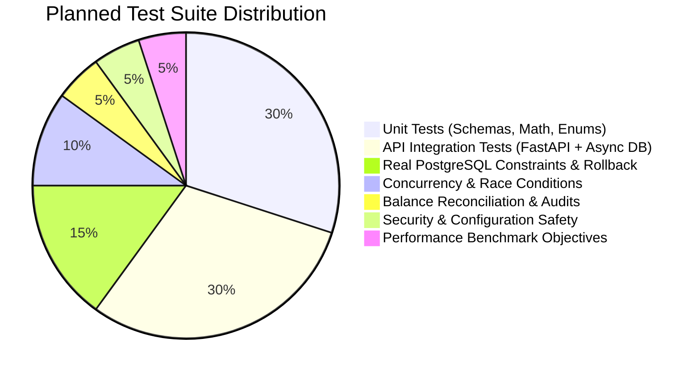

# Transaction Ledger API — Comprehensive Verification & Test Strategy

**Document Version:** 1.1.0  
**Status:** DRAFT — AWAITING REVIEW (Phase 0 Revised)  
**Author:** Principal Backend Engineer & Application Security Architect  

---

## 1. Quality & Verification Principles

In financial ledger engineering, testing is the primary mechanism for establishing mathematical correctness and operational safety:

1. **No SQLite Substitution for Real Database Tests:** SQLite does not implement PostgreSQL's row-locking semantics (`SELECT ... FOR UPDATE`), transaction isolation levels, or concurrent connection behavior. All transaction, concurrency, constraint, and rollback tests must execute against a real PostgreSQL 16 container.
2. **No Unsubstantiated Verification Claims:** Tests must produce explicit assertion logs, execution timings, and verification metrics. We never claim a test passes without actual execution command output.
3. **Static Scanners Do Not Prove Security:** Clean reports from Bandit, Ruff, and pip-audit confirm adherence to static rules and absence of known CVEs, but do not prove that custom business logic is vulnerability-free or that race conditions cannot occur.
4. **Measured Benchmark Objectives Over Absolute Claims:** We avoid speculative claims like "guaranteed under 5 ms." Instead, performance is evaluated against defined benchmark objectives in specified testing environments.

---

## 2. Test Suite Classification



---

## 3. Test Categories & Verification Specifications

### 3.1 Unit Tests (Pure Python / In-Memory)
- **Scope:** Fast, deterministic checks on pure functions, Pydantic schemas, and domain state transitions without I/O.
- **Specific Test Cases:**
  - `test_amount_validation_positive_integer`: Validates that positive integers are accepted and floats/strings/negative values are rejected.
  - `test_account_name_whitespace_stripping`: Validates that trailing/leading whitespace is trimmed and whitespace-only strings fail.
  - `test_transaction_type_enum`: Validates that only `'credit'` and `'debit'` are permitted.
  - `test_error_schema_serialization`: Validates standard error envelope formatting.
  - `test_pagination_bounds`: Verifies `page=0` or `limit=101` raise immediate validation errors.
- **Definition of Correctness:** 100% of invalid inputs rejected before touching service or database layers.
- **Evidence Required:** Full pytest console output and coverage report.

### 3.2 API Integration Tests (FastAPI + Async HTTPX)
- **Scope:** Complete HTTP request/response cycle testing all endpoints against an active PostgreSQL test database.
- **Specific Test Cases:**
  - `test_create_account_zero_balance`: Asserts account created with `balance_minor = 0` and HTTP 201.
  - `test_create_account_disallows_client_balance`: Asserts client cannot initialize non-zero balance.
  - `test_add_credit_success`: Asserts balance increases by credit amount.
  - `test_add_debit_success`: Asserts balance decreases by debit amount.
  - `test_add_debit_insufficient_funds`: Asserts debit exceeding balance returns HTTP 422 with `INSUFFICIENT_FUNDS` and balance is unchanged.
  - `test_get_balance_not_found`: Asserts non-existent UUID returns HTTP 404 with `ACCOUNT_NOT_FOUND`.
  - `test_transaction_history_filtering`: Asserts querying `?type=credit` returns only credit items.
  - `test_transaction_history_pagination`: Verifies `page`, `limit`, `total_records`, and `total_pages` calculations.
  - `test_transaction_history_order`: Verifies items are returned strictly in newest-first order (`created_at DESC, id DESC`).
- **Definition of Correctness:** HTTP response statuses, headers, and JSON bodies match the API contract specification exactly.
- **Evidence Required:** pytest execution traces with request/response assertion output.

### 3.3 Real PostgreSQL Tests (Integrity, Constraints & Rollback)
- **Scope:** Validates database engine invariants, foreign keys, and transaction rollbacks under real PostgreSQL.
- **Specific Test Cases:**
  - `test_pg_check_constraint_balance_non_negative`: Executes raw SQL attempting to set `balance_minor = -1`; verifies PostgreSQL raises `check_violation` (SQLSTATE `23514`).
  - `test_pg_unique_reference_per_account`: Attempts inserting two transactions with identical `(account_id, reference_id)`; verifies `unique_violation` (SQLSTATE `23505`).
  - `test_pg_same_reference_different_accounts`: Successfully inserts identical `reference_id` into two distinct accounts.
  - `test_pg_foreign_key_account_id`: Attempts inserting transaction for random UUID; verifies `foreign_key_violation` (SQLSTATE `23503`).
  - `test_pg_atomic_rollback_on_failure`: Injects an intentional exception after account balance update but before transaction commit; asserts database rollback leaves balance completely unchanged and creates zero ledger rows.
  - `test_pg_transaction_immutability`: Confirms that the application runtime user role (`ledger_app`) cannot execute `UPDATE` or `DELETE` on the `transactions` table.
- **Definition of Correctness:** PostgreSQL engine rejects invalid operations directly at the storage level.
- **Evidence Required:** Captured SQLSTATE codes and database logs verifying rollback.

### 3.4 Concurrency Tests (Races, Deadlocks & Thread Interleaving)
- **Scope:** Multi-threaded or async task execution hammering the API simultaneously to expose race conditions.
- **Specific Test Cases:**
  - `test_concurrent_competing_debits_prevent_overdraft`:
    - Setup: Account initial balance = ₹100 (`10000` paise).
    - Action: Spawn 10 simultaneous workers, each attempting a debit of ₹20 (`2000` paise) (Total attempted: ₹200).
    - Expected Result: Exactly 5 debits succeed (5 x 2000 = 10000); exactly 5 debits fail with `INSUFFICIENT_FUNDS`. Final balance must be exactly `0`.
  - `test_concurrent_duplicate_reference_submission`:
    - Action: Fire 5 identical requests with the same `(account_id, reference_id)` simultaneously.
    - Expected Result: Exactly 1 request succeeds (HTTP 201); exactly 4 requests are rejected with HTTP 409 (`DUPLICATE_REFERENCE`). Balance is debited or credited exactly once.
  - `test_concurrent_opposing_transfers_deadlock_handling`:
    - Setup: Account A balance = ₹1,000; Account B balance = ₹1,000.
    - Action: 20 concurrent threads running Transfer A -> B while 20 concurrent threads run Transfer B -> A.
    - Expected Result: Deterministic lock ordering minimizes deadlocks. If a transient deadlock (`40P01`) occurs due to concurrent table access, the application rolls back cleanly and client retry succeeds. Final sum(A.balance + B.balance) must equal exactly ₹2,000 (`200000` paise).
- **Definition of Correctness:** Zero negative balances, zero lost updates, zero double-executions, and 100% mathematical balance reconciliation.
- **Evidence Required:** Final balance audit logs and thread completion metrics.

### 3.5 Financial Balance Reconciliation Audit Test
- **Scope:** Mathematical proof of data integrity across accounts.
- **Specific Test Case:**
  - `test_balance_reconciliation_audit`:
    - Executes:
      ```sql
      SELECT 
          a.id AS account_id,
          a.balance_minor AS stored_balance,
          COALESCE(SUM(CASE WHEN t.type = 'credit' THEN t.amount_minor ELSE -t.amount_minor END), 0) AS calculated_balance
      FROM accounts a
      LEFT JOIN transactions t ON a.id = t.account_id
      GROUP BY a.id, a.balance_minor;
      ```
    - Asserts that for 100% of accounts, `stored_balance == calculated_balance`.
- **Definition of Correctness:** Zero variance between stored snapshot balance and calculated transaction ledger balance.

### 3.6 Security & Environment Configuration Tests
- **Scope:** Automated verification of security posture and environment configuration safety.
- **Specific Test Cases:**
  - `test_production_config_rejects_unauthenticated_mode`: Sets `ENVIRONMENT=production` and `ALLOW_UNAUTHENTICATED_ACCESS=True`; asserts application fails to boot with a fatal configuration error.
  - `test_error_sanitization_no_stack_traces`: Triggers an unhandled database exception; verifies client response contains zero python tracebacks or SQL syntax.
  - `test_sql_injection_resilience`: Injects SQL vectors into all string fields; verifies strings are treated as inert literals.
  - `test_payload_size_enforcement`: Sends a 10MB payload; verifies server rejects immediately with HTTP 413 or 422.
- **Static Tooling Verification:**
  - `ruff check .` (Zero lint or formatting issues).
  - `pyright` (Zero type errors under strict type checking).
  - `bandit -r src/` (Zero high or medium severity security warnings).
  - `pip-audit` (Zero known CVEs in dependency tree).

### 3.7 Performance Benchmark Objectives
- **Scope:** Verifies that database indexes scale cleanly under realistic data volumes.
- **Benchmark Objective:**
  - *Testing Environment:* Docker container running PostgreSQL 16 allocated 2 CPU cores and 4 GB RAM; connection pool size of 20.
  - *Dataset:* Account seeded with 100,000 transactions.
  - *Measurement:* Execute `EXPLAIN (ANALYZE, BUFFERS)` on `GET /api/v1/accounts/{id}/transactions?page=1&limit=20`.
  - *Target Objective:* Query plan must execute an **Index Scan** using `idx_transactions_history` (`account_id, created_at DESC, id DESC`), with an execution latency target of < 20 ms under warm buffer cache conditions.
- **Evidence Required:** Captured PostgreSQL query execution plan buffers and timing logs.
